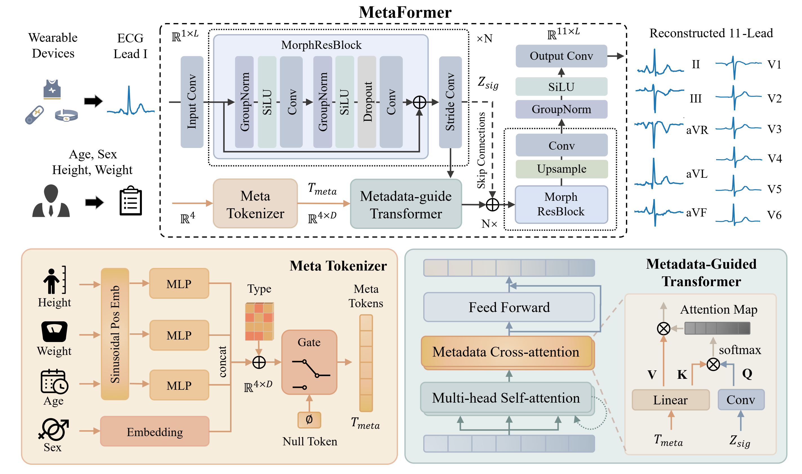
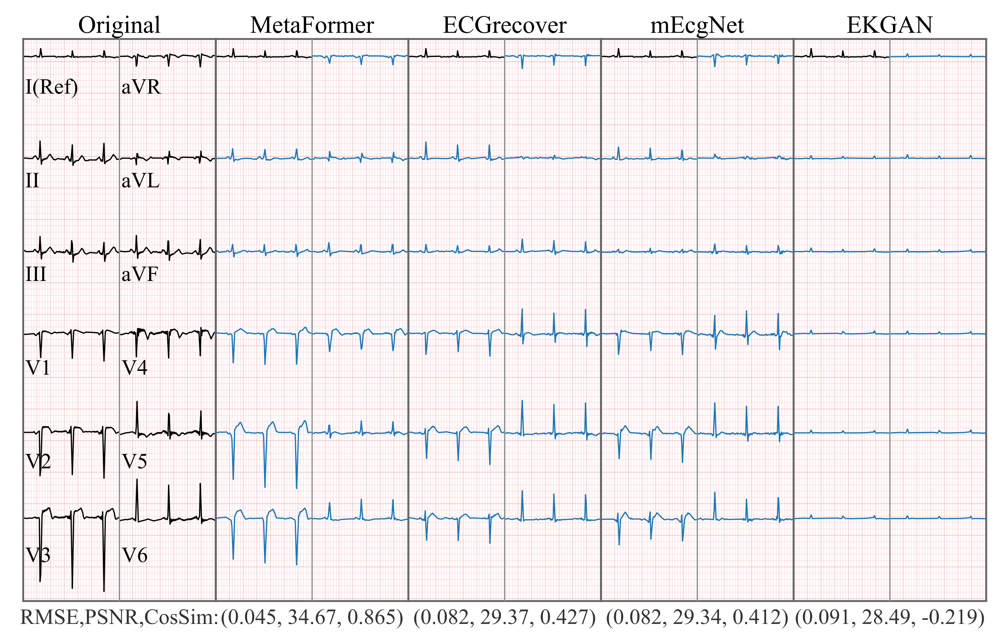
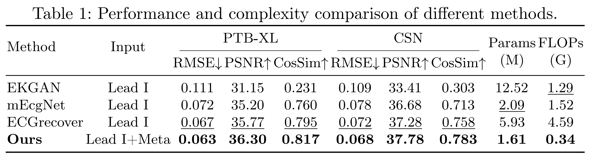

# MetaFormer

[MICCAI 2026] The official implementation of our paper **"MetaFormer: Metadata-Guided Transformer for Patient-Aware 12-Lead ECG Reconstruction"**.

## Introduction

Reconstructing 12-lead electrocardiogram (ECG) signals from single-lead wearable recordings bridges the gap between long-term monitoring for critical paroxysmal events and the clinical gold standard required for accurate diagnosis. However, existing methods usually treat this ill-posed inverse problem as a generic regression task, failing to resolve physiological ambiguities and consequently reconstructing toward population averages. To address these problems, we propose MetaFormer, an efficient reconstruction network that utilizes demographic characteristics to enforce patient-aware physical consistency. We introduce a meta tokenizer to parse heterogeneous clinical metadata into a unified semantic manifold, which establishes patient-specific physiological context to guide the reconstruction. To reduce the cross-lead spatial ambiguity, a metadata-guided Transformer aligns latent representations of the reconstructed signal with individual physiological baselines. Experimental results on two large-scale benchmarks demonstrate that MetaFormer outperforms other state-of-the-art methods while reducing computational cost by ${\sim}73\%$, and closely approaches the performance of original 12-lead ECG signals on downstream arrhythmia classification. The code is available at [here](https://github.com/xych3/MetaFormer).

## Overview

MetaFormer reconstructs 11 target leads from a single Lead-I input, conditioned on patient metadata (age, sex, height, weight). The model consists of:

- **Meta Tokenizer** — encodes heterogeneous clinical metadata into a unified token sequence.
- **Metadata-guided Transformer** — a 1D U-Net with cross-attention that fuses reference lead features with metadata tokens to predict target leads.



## Repository Structure

```
├── config/                  # YAML configuration files
│   ├── metaformer.yaml
│   ├── ekgan.yaml
│   ├── mecgnet.yaml
│   └── ecgrecover.yaml
├── data_preparation/        # Dataset preprocessing and loading
│   ├── prepare_ptbxl.py
│   ├── prepare_csn.py
│   └── ecg_dataset.py
├── model/                   # MetaFormer model definition
│   ├── condition_unet_recon.py
│   └── meta_tokenizer.py
├── baseline/                # Baseline model implementations
│   ├── ekgan.py
│   ├── mecgnet.py
│   └── ecgrecover.py
├── experiment/              # Training and evaluation logic
│   ├── trainer.py / evaluator.py
│   └── trainer_*.py / evaluator_*.py
├── utils/                   # Metrics and utilities
├── run.py                   # Unified CLI for MetaFormer
├── run_baseline.py          # CLI for baseline models
├── train.py                 # Training entry point
├── eval.py                  # Evaluation entry point
└── recon.py                 # Reconstruction method wrappers
```

## Requirements

- Python >= 3.8
- PyTorch >= 2.0
- CUDA-compatible GPU (recommended)

Install dependencies:

```bash
pip install -r requirements.txt
```

## Datasets

This codebase supports two publicly available 12-lead ECG databases:

| Dataset | Description |
|---------|-------------|
| [PTB-XL](https://physionet.org/content/ptb-xl/) | 21,799 clinical 12-lead ECG records (10 s, 500 Hz) |
| [CSN](https://physionet.org/content/ecg-arrhythmia/) | Chapman-Shaoxing-Ningbo database of 12-lead ECG records |

### Data Preparation

Preprocess raw datasets into the format required for training:

```bash
# Prepare both datasets
python run.py prepare --dataset all --data-root /path/to/raw/data

# Prepare a single dataset
python run.py prepare --dataset ptbxl --data-root /path/to/ptbxl --output data/ptbxl
python run.py prepare --dataset csn   --data-root /path/to/csn   --output data/csn
```

Preprocessed data will be saved under `data/ptbxl/` and `data/csn/` by default. Each sample consists of a 12-lead ECG signal (resampled to 512 time steps) and associated patient metadata.

## Usage

### MetaFormer

**Training:**

```bash
python run.py train --config config/metaformer.yaml

# Resume from checkpoint
python run.py train --config config/metaformer.yaml --resume outputs/metaformer/checkpoints/latest.pth
```

**Evaluation:**

```bash
python run.py eval --config config/metaformer.yaml --checkpoint outputs/metaformer/checkpoints/best.pth

# Evaluate on a specific dataset
python run.py eval --config config/metaformer.yaml --dataset ptbxl
```

### Baseline Models

**Training:**

```bash
python run_baseline.py --mode train --model ekgan      --config config/ekgan.yaml
python run_baseline.py --mode train --model mecgnet     --config config/mecgnet.yaml
python run_baseline.py --mode train --model ecgrecover  --config config/ecgrecover.yaml
```

**Evaluation:**

```bash
python run_baseline.py --mode eval --model ekgan      --config config/ekgan.yaml      --checkpoint /path/to/checkpoint.pth
python run_baseline.py --mode eval --model mecgnet     --config config/mecgnet.yaml    --checkpoint /path/to/checkpoint.pth
python run_baseline.py --mode eval --model ecgrecover  --config config/ecgrecover.yaml --checkpoint /path/to/checkpoint.pth
```

## Configuration

All hyperparameters are specified in YAML files under `config/`. Key sections include:

| Section | Parameters |
|---------|------------|
| `data` | Dataset selection, signal length, condition leads, batch size |
| `model` | Meta Tokenizer and U-Net architecture hyperparameters |
| `training` | Optimizer, scheduler, epochs, gradient accumulation, early stopping |
| `evaluation` | Metrics, per-lead evaluation, number of evaluation samples |

Refer to `config/metaformer.yaml` for the full list of configurable options.

## Results





## Reference

If you found our work useful in your research, please consider citing our works at:

> 

